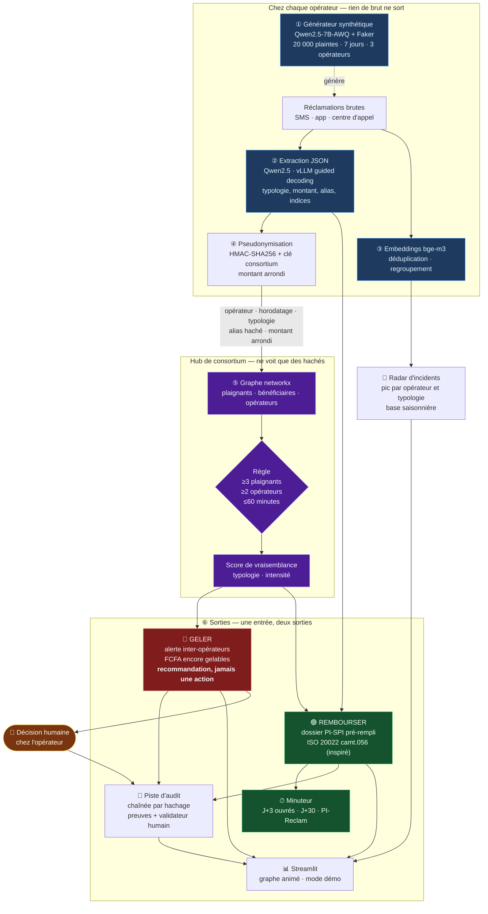

# Réclam'Graph

**Analyse intelligente des réclamations clients** : croiser les plaintes de plusieurs
opérateurs pour démasquer les comptes mules avant le retrait, et transformer chaque
plainte légitime en dossier de litige PI-SPI dans les délais.

> **Chaque plainte est un capteur. Seule, elle ne dit rien. Croisée entre opérateurs,
> elle révèle le compte mule avant le retrait, et elle devient d'elle-même un dossier
> de litige PI-SPI conforme aux délais.**

GPU Challenge 2026 — équipe **Token Titans** (équipe 12).

---

## ⚠️ Avertissement, en haut de page

**Toutes les données de ce dépôt sont synthétiques.** Les opérateurs `ALPHAMONEY`,
`BETACASH` et `GAMMAPAY` sont **fictifs**. Aucun chiffre produit ici ne décrit un
opérateur réel. Le générateur ([`src/reclam_graph/datagen/`](src/reclam_graph/datagen/))
et la vérité terrain ([`data/ground_truth.json`](data/ground_truth.json)) sont publiés :
la démonstration est reproductible, mais elle décrit un scénario simulé.

Le corpus lui-même (`data/complaints.jsonl`, 12 Mo) n'est pas versionné : il se
**régénère à l'identique en une seconde** avec `make data`, car le générateur est
déterministe à graine fixe. Ce qui est versionné, c'est ce qui permet de vérifier —
le générateur, la vérité terrain et l'annuaire d'alias. Un test
(`test_le_generateur_est_deterministe`) vérifie que deux générations successives
donnent le même fichier, octet pour octet.

Deuxième engagement : **aucun débit, aucune exactitude et aucun coût n'est annoncé
sans avoir été mesuré.** Chaque chiffre de ce README est régénéré depuis `results/`
par [`scripts/refresh_results_block.py`](scripts/refresh_results_block.py). Ce qui
n'a pas pu être mesuré est écrit « non mesuré » ou « non calculé », jamais estimé en
silence. Les estimations issues de sources extérieures portent l'étiquette
« estimation » ou « hypothèse ».

---

## 1. Le problème, en chiffres

Les chiffres de cette section viennent des publications BCEAO et des sources listées
en [section 9](#9-hypothèses-et-limites). Ils décrivent le contexte, pas nos mesures.

- **2,65 millions de réclamations** reçues par les émetteurs de monnaie électronique
  de l'UEMOA au second semestre 2021, pour 2,97 milliards d'opérations — environ
  **0,9 réclamation pour 1 000 transactions** *(calcul)*.
- Motifs principaux : **erreur de bénéficiaire** lors d'un dépôt ou d'un transfert,
  changement de numéro, annulation d'un transfert.
- **635 435 cas de fraude** au premier semestre 2021, puis 310 274 au second — très
  majoritairement de l'**ingénierie sociale** : codes OTP, arnaque à l'« erreur de
  dépôt », faux paiements marchands. Valeur déclarée faible (~3 400 FCFA par cas) :
  massif en nombre, sous-déclaré en valeur.
- **PI-SPI** (lancé le 30 septembre 2025) traite un paiement en 20 secondes, en
  ISO 20022, avec un alias qui masque le numéro — et rend le paiement
  **irrévocable** : une annulation exige l'accord du bénéficiaire. En novembre 2026 :
  **175 institutions connectées**, plus de 4 millions de transactions.
- Le canal d'escalade est quasi vide : **25 réclamations** traitées par le SGCB-UMOA
  en 2021, 475 dossiers à l'OQSF du Sénégal en 2025.

### Pourquoi cette idée

La réclamation la plus fréquente (« j'ai envoyé au mauvais numéro ») et la fraude la
plus fréquente (« je me suis trompé de numéro, renvoyez-moi l'argent ») **racontent la
même histoire avec les mêmes mots**.

Un opérateur seul ne peut pas distinguer la victime d'une erreur sincère de la victime
d'une fraude quand le bénéficiaire frauduleux est client d'un autre réseau. PI-SPI rend
l'arnaque à l'« erreur de dépôt » interopérable par construction — victime chez un
opérateur, mule chez un autre, transfert irrévocable — et **chaque opérateur ne voit
que la moitié du dossier**.

PI-Reclam transporte les réclamations entre participants mais, d'après l'information
publique, c'est un **tuyau** : rien de public ne dit qu'il les analyse et les corrèle.
C'est la place que prend Réclam'Graph.

Ce n'est pas une intuition : [la mesure du sous-corpus ambigu](#3-résultats-mesurés)
montre qu'**aucun moteur de lecture de texte ne dépasse le taux de la classe
majoritaire** sur les plaintes où les deux récits se confondent.

### À qui cela sert

- **Utilisateur principal** : le **responsable litiges et fraude** d'un établissement
  de monnaie électronique ou d'une banque participant à PI-SPI. Il doit tenir des
  délais de 3 jours ouvrés et d'un mois, récupérer des fonds, éviter des pénalités.
- **Utilisateurs secondaires** : agents de centre de contact (dossier pré-rempli),
  équipe PI-Reclam ou BCEAO (vue consolidée des campagnes de fraude), agrégateurs de
  type Payfonte (litiges marchands).

---

## 2. Comment ça marche, en quatre étapes

1. **Lire** — la réclamation brute (SMS, application, centre d'appel, note vocale)
   devient un enregistrement structuré : typologie, montant, heure, alias du
   bénéficiaire, réseau de destination, indices d'arnaque.
2. **Pseudonymiser** — chez chaque opérateur, l'alias du bénéficiaire est haché
   (HMAC-SHA256) avec une clé de consortium. Seuls le haché et quelques métadonnées
   minimales quittent l'opérateur.
3. **Croiser** — le hub construit un graphe des plaignants, des bénéficiaires et des
   opérateurs. **Au moins 3 plaignants indépendants, sur au moins 2 réseaux, dans une
   fenêtre de 60 minutes** lèvent une alerte « mule probable ».
4. **Agir** — mule probable : les opérateurs concernés sont prévenus, avec le montant
   encore gelable. Erreur sincère : demande d'annulation pré-remplie, minuteur
   réglementaire, piste d'audit.

### Le principe non négociable

> **Réclam'Graph recommande et documente ; il ne gèle jamais de lui-même.**

La décision reste **humaine**, chez l'opérateur. Les seuils sont **visibles dans la
démonstration** : 2 opérateurs distincts minimum, 3 plaignants indépendants minimum.
Tout est tracé dans l'audit, avec les preuves et le nom de la personne qui valide.
Les alertes sous le seuil de score ne sont jamais supprimées en silence : elles sont
affichées « à qualifier », et c'est l'opérateur qui tranche.

### Les fonctions

| Fonction | Ce qu'elle fait | Valeur pour le client |
|---|---|---|
| Extracteur de réclamations | LLM local à sortie JSON guidée ; robuste aux fautes, au français local mélangé, aux montants écrits « 25mil » ou « 25.000F » | Fin de la ressaisie manuelle |
| Radar mules inter-opérateurs | Graphe pseudonymisé, règle et score, fenêtre glissante ; liste des opérateurs à prévenir | Fonds gelés avant le retrait |
| Radar d'incidents | Regroupement par embeddings et détection de pic : panne PI-SPI, timeouts d'un réseau | Incident repéré avant l'avalanche de tickets |
| Dossier de litige PI-SPI | Demande d'annulation pré-remplie, format inspiré d'ISO 20022, avec les preuves extraites | Moins de temps agent par dossier |
| Minuteur réglementaire | J+3 jours ouvrés (art. 35), J+30 (Circulaire CB), échéance PI-Reclam paramétrable ; alertes avant expiration | Pénalités évitées |
| Piste d'audit | Chaque décision tracée en JSON avec ses preuves et son validateur humain | Conformité démontrable au régulateur |

Réutilisé de **Réclam'Radar** : bge-m3, vLLM, Streamlit et le module de regroupement.
Le pivot porte sur **ce que l'on fait des réclamations**, pas sur la pile technique.

---

## 3. Résultats mesurés

La **référence** est l'opérateur seul avec son tri par mots-clés, c'est-à-dire la
situation actuelle. Détail complet : [`results/benchmark.md`](results/benchmark.md) et
[`results/benchmark.json`](results/benchmark.json).

<!-- RESULTATS:DEBUT -->

> Chiffres régénérés depuis `results/` par `scripts/refresh_results_block.py`.  
> **Exécution : CPU run — aucun GPU détecté (ne pas présenter comme des chiffres GPU)**  
> Corpus : 20 000 réclamations synthétiques sur 7 jours, 3 opérateurs fictifs.  
> Généré le 2026-11-25 à 08:21:38.

### Détection de comptes mules — l'écart principal

| Métrique | Référence : opérateur seul | Réclam'Graph (consortium) |
|---|---|---|
| Rappel des campagnes | **60%** (3/5) | **100%** (5/5) |
| Délai de détection (médiane) | 29 min | **13 min** |
| FCFA encore gelables (5 campagnes) | 367 000 FCFA | **920 000 FCFA** |
| Précision des alertes | 75% | 42% règle brute → **100%** après score |

Règle appliquée : **3 plaignants indépendants, 2 opérateurs distincts, fenêtre de 60 minutes**. Réclam'Graph recommande et documente ; il ne gèle jamais de lui-même.

### Typologie — « quasi ex aequo », et nous le disons

| Approche | F1 macro |
|---|---|
| Référence mots-clés + regex | 0,778 |
| Référence TF-IDF + régression logistique (**supervisée**) | **0,98** |
| Extracteur Réclam'Graph (sans étiquettes) | 0,807 |

La référence supervisée **gagne**. C'est attendu, c'est publié tel quel, et c'est pourquoi la démonstration ne repose pas sur la classification.

#### Le sous-corpus ambigu (1 330 plaintes, 6.7% du corpus)

Des plaintes dont le texte sert **indifféremment** à une arnaque « erreur de dépôt » et à une erreur sincère de destinataire. Comparaison au taux de la classe majoritaire, c'est-à-dire au score d'un système qui répondrait toujours la même chose :

| Moteur | Exactitude | Taux classe majoritaire | Gain |
|---|---|---|---|
| reference_regex | 48.0% | 90.5% | **-42.4%** |
| heuristique_locale | 48.1% | 90.5% | **-42.3%** |
| TF-IDF + logreg (supervisée) | 84.4% | 89.5% | **-5.0%** |

**Aucun moteur ne dépasse le taux de la classe majoritaire.** Sur ces textes, lire la plainte ne suffit pas. C'est la mesure qui porte tout le projet : le signal utile n'est pas dans une plainte, il est dans le croisement de plusieurs.

### Extraction de champs

F1 sur les cas **récupérables** (la valeur est réellement présente dans le texte), puis entre parenthèses la F1 brute sur tous les cas de la vérité terrain, y compris ceux que le texte ne mentionne pas.

| Champ | Référence regex | Extracteur local | Cas récupérables |
|---|---|---|---|
| montant_fcfa | 0,854 (0,854) | 0,969 (0,969) | 18 851 / 18 851 |
| alias_beneficiaire | 1 (0,82) | 1 (0,82) | 4 937 / 7 100 |
| msisdn_beneficiaire | 1 (0,429) | 1 (0,429) | 1 940 / 7 093 |
| reseau_destination | 1 (0,715) | 1 (0,715) | 7 108 / 12 769 |
| heure_operation | 0,94 (0,293) | 0,94 (0,293) | 3 878 / 20 000 |
| **moyenne** | **0,959** (0,622) | **0,982** (0,645) | |

Le seul champ qui sépare vraiment les deux moteurs est le **montant** : la regex lit « 25 000 » et « 25.000F », elle ne lit pas « 25mil », « 25k » ni « vingt cinq mille ». C'est là que le LLM est attendu.

### Radar d'incidents

- Incidents injectés : **1** — détectés : **1** (rappel 100%)
- Alertes émises au total : **2** — précision **50%** (1 faux positif(s))
- Délai de détection : **60 min** après le début réel du pic (granularité horaire), score de pic **29 σ**

> Les faux positifs du radar sont des fluctuations au plancher de détection (quelques dizaines de plaintes au-dessus de l'ordinaire). Les seuils (25 plaintes minimum, x2.0 le volume habituel) n'ont PAS été ajustés pour les faire disparaître : les relever jusqu'à obtenir une précision parfaite sur ce jeu reviendrait à régler le détecteur sur les données d'évaluation.

### Moteur d'embeddings — bge-m3 contre le repli TF-IDF

Mesuré sur 300 réclamations — *CPU run — aucun GPU détecté (ne pas présenter comme des chiffres GPU)* :

| Moteur | Dimension | Débit | Durée |
|---|---|---|---|
| `bge-m3` (la cible) | 1024 | 5,02 textes/s | 59,715 s |
| `tfidf-svd` (le repli) | 256 | 237,66 textes/s | 1,262 s |

> bge-m3 tourne et produit des vecteurs de dimension 1024, mais à 5.02 textes/s sur ce matériel, les 20000 réclamations demanderaient environ 1.1 h. C'est la raison chiffrée pour laquelle le pipeline livré utilise le repli TF-IDF au-delà de 2000 textes sur CPU, et bge-m3 dès qu'un GPU est présent. Le choix est mesuré, pas supposé.

### Partage minimal et traçabilité

- Réclamations traitées : **20 000**
- Enregistrements transmis au hub : **6 825** (**34.1%**) — une plainte sans bénéficiaire identifiable ne quitte pas l'opérateur
- Décisions sur le corpus complet : {'REMBOURSER': 5524, 'A_INSTRUIRE': 14438, 'GELER': 38}
- Entrées d'audit : **213**, chaîne de hachage intègre : **oui**

### Débit et coût

| Grandeur | Valeur | Étiquette |
|---|---|---|
| Débit référence regex | 45 215,96 réclamations/s | CPU run — aucun GPU détecté (ne pas présenter comme des chiffres GPU) |
| Débit extracteur local | 29 408,78 réclamations/s | CPU run — aucun GPU détecté (ne pas présenter comme des chiffres GPU) |
| Débit LLM | non mesuré requêtes/s | à mesurer sur la machine GPU (`make bench-llm`) |
| Prix horaire GPU | non calculé | paramètre `config.py` |
| Inférence locale / 1 000 réclamations | non calculé | calculé dès que le prix horaire est renseigné |
| API cloud / 1 000 | non calculé | paramètre `config.py` |
| Agent humain / 1 000 (simple) | 270 000 FCFA | estimation (offres d'emploi, section 12) |
| Agent humain / 1 000 (investiguée) | 700 000 FCFA | estimation (offres d'emploi, section 12) |
| Repère — Intercom Fin (par résolution) / 1 000 | 590 000 FCFA | prix public affiché |
| Repère — Thematic (par commentaire) / 1 000 | 600 000 FCFA | prix public affiché |
| Prix proposé / 1 000 | 5 000 FCFA | **hypothèse** de modèle économique |

- Le prix horaire du GPU et le tarif API cloud sont des paramètres de `config.py` à remplir depuis leurs sources. Vides, ils donnent « non calculé » — aucun coût n'est inventé.
- Les coûts humains (270 / 700 FCFA par réclamation) sont des ESTIMATIONS issues d'offres d'emploi, pas des mesures.
- Les repères éditeurs (Intercom Fin, Thematic) sont des prix publics affichés, pas des mesures de notre part.
- Le prix proposé de 5 FCFA par réclamation est une HYPOTHÈSE de modèle économique.
- AUCUN GPU DÉTECTÉ : le débit ci-dessus est un débit CPU. Il ne doit pas être présenté comme un débit GPU.

<!-- RESULTATS:FIN -->

---

## 4. Architecture

Six blocs. Les trois premiers sont ceux qui tournent sur GPU.



### Les scénarios injectés dans les données

- **5 campagnes d'arnaque « erreur de dépôt »**, chacune vers un compte mule, avec des
  victimes réparties sur les 3 opérateurs. Spécifiées explicitement dans
  [`datagen/scenarios.py`](src/reclam_graph/datagen/scenarios.py) pour que la démo soit
  rejouable au chiffre près.
- **1 incident PI-SPI** : vague de timeouts sur les trois réseaux, pour le radar.
- **600 arnaques « erreur de dépôt » isolées** : une victime seule. Elles ne doivent
  **pas** lever d'alerte, et produisent un dossier de remboursement. Elles donnent à la
  classe « arnaque » un poids réaliste et mesurent la précision.
- **Erreurs sincères de bénéficiaire**, qui doivent produire un remboursement.
- **2 leurres** : grappes légitimes (facturier très sollicité) qui déclenchent la règle
  brute **sans aucune fraude**. Sans eux, la précision mesurée serait un 1,00 fabriqué.
- **Du texte ambigu** : des gabarits identiques pour une arnaque et pour une erreur
  sincère. Sans eux, des n-grammes de caractères atteignent 1,00 de F1 macro sur ce
  corpus, ce qui ne mesure que la séparabilité des gabarits.
- **Du bruit** : fautes de frappe, abréviations SMS, nouchi, mots fon, plaintes sans
  lien, 15 formats de montant.
- **Un délai de retrait simulé par mule**, qui permet de chiffrer les FCFA encore gelables.

---

## 5. Démarrage rapide

```bash
make setup      # .venv + dépendances CPU épinglées
make data       # 20 000 réclamations synthétiques + vérité terrain
make pipeline   # lire → pseudonymiser → croiser → agir
make bench      # référence contre solution → results/benchmark.{json,md}
make readme     # réinjecte les chiffres mesurés dans ce README
make demo       # interface Streamlit en MODE DÉMO (sans GPU)
```

> `make bench` remesure les débits sur la machine courante : ils changent donc d'une
> exécution à l'autre. `make readme` réinjecte les valeurs mesurées dans le bloc
> « Résultats mesurés » ci-dessus, et `make all` l'appelle automatiquement avant les
> tests. Aucun chiffre de ce README n'est saisi à la main.

Les trois commandes qui suffisent pour tout reproduire :

```bash
make setup && make all      # données, pipeline, banc de mesure, tests
make demo                   # la démonstration
make test                   # 123 tests
```

### Avec un GPU

```bash
cp .env.example .env                  # puis remplir si besoin
make setup-gpu                        # torch, vLLM, sentence-transformers
make serve-llm                        # choisit Qwen2.5-7B-AWQ ou 3B selon la VRAM
# dans un second terminal :
bash scripts/record_gpu_evidence.sh   # preuve nvidia-smi → results/gpu_log.txt
make pipeline-llm && make bench-llm   # mesure réelle du LLM
make readme                           # réinjecte ces mesures dans le README
```

`make serve-llm` choisit le modèle d'après la VRAM détectée : **Qwen2.5-7B-Instruct-AWQ**
au-delà de 12 Go (sur T4, en **fp16/half**, car le T4 n'a pas de bf16), **Qwen2.5-3B-Instruct**
en dessous, pour le débit. Tous les appels LLM passent par un unique client compatible
OpenAI (`LLM_BASE_URL`, `LLM_MODEL`) : **vLLM et Ollama sont interchangeables**.

### Le mode démo

Le mode démo est le **mode par défaut**, et c'est volontaire : il rejoue
`results/demo_bundle.json`, **sans aucun appel LLM ni GPU**. Les trois minutes de
démonstration ne doivent pas dépendre d'une session GPU en direct.

---

## 6. Ce qui quitte l'opérateur

| Champ | Partagé ? |
|---|---|
| Texte de la réclamation | **Non** |
| Identité et numéro du plaignant | **Non** (haché, uniquement pour compter des plaignants distincts) |
| Alias du bénéficiaire | **Haché** (HMAC-SHA256) |
| Opérateur, horodatage, typologie | Oui |
| Montant | **Arrondi** (pas de 5 000 FCFA) |

Une réclamation sans bénéficiaire identifiable **ne quitte pas** l'opérateur : elle
n'apporterait rien au hub et augmenterait la surface de données. En pratique, environ
un tiers du corpus est partagé — le chiffre exact est dans le bloc de résultats.

Le hub ne reçoit pas non plus les **indices d'arnaque** extraits du texte : la typologie
est le seul signal de fraude disponible côté hub, et c'est assumé.

### La limite, énoncée avant qu'on nous la pose

> Un **HMAC sur des numéros de téléphone reste attaquable par dictionnaire si la clé
> fuite** : l'espace des numéros béninois est petit (~10⁶ par préfixe). Le HMAC protège
> contre un hub curieux, **pas** contre un hub malveillant qui détiendrait la clé.

En production : **private set intersection (PSI)**, ou un hub opéré par un **tiers de
confiance** (BCEAO, PI-Reclam, Alliance Fintech UEMOA). Le montant partagé est déjà
arrondi et le texte ne sort jamais, ce qui limite la casse en cas de fuite.

**24 % des fournisseurs de mobile money** se disent gênés par les règles de transfert
transfrontalier de données (GSMA 2026) : le partage minimal et l'inférence locale sont
des **arguments**, pas des contraintes.

---

## 7. Ce qui existe déjà — nous ne prétendons rien d'inédit

Tout ce qui concerne l'analyse des réclamations **d'une seule entreprise** est déjà
couvert, souvent bien, à un prix incompatible avec l'UEMOA. **Le vide est entre les
institutions.**

| Catégorie | Acteurs | Pourquoi cela ne couvre pas notre cas |
|---|---|---|
| Analyse de la voix du client | Thematic, Chattermill, Enterpret, Medallia, Qualtrics | Mono-entreprise, ~1 USD par commentaire, ignore PI-SPI et le français local mélangé, ne relie rien à une transaction |
| Agents de service IA | Intercom Fin (0,99 USD/résolution), Zendesk AI, Copilot Studio | Même problème de prix, aucun accès aux données des autres opérateurs, hébergement hors zone |
| SupTech réclamations | Proto / BSP (Philippines), Cambridge SupTech Lab, RBI CMS | Le régulateur voit les réclamations escaladées, pas la première ligne en temps réel ; aucune corrélation anti-fraude entre institutions |
| Écoute sociale | IPA / Citibeats, FSD Kenya | Échantillon non représentatif, aucun lien à une transaction |
| Fraude transactionnelle | Outils internes des opérateurs, Feedzai, Featurespace, SAS, BioCatch | Vue mono-opérateur ; l'usage des réclamations comme signal n'est **pas vérifié** et reste une hypothèse de notre part |
| Infrastructure régionale | **BCEAO PI-Reclam** | Échange centralisé des réclamations, avec délais et pénalités : un tuyau, sans analyse publique connue. **Le concurrent potentiel le plus dangereux.** |
| Registres de fraude mutualisés | Registre central RBI, consortiums bancaires ailleurs | Rien de public en UEMOA, et alimentés par des déclarations, pas par le texte des réclamations clients |

### Ce que dit la recherche, et que nous respectons

- Sur la **classification** de réclamations, le LLM n'apporte presque rien en zero-shot :
  un TF-IDF réglé atteint ~87 % d'exactitude sur la base CFPB. **Nous ne construisons
  donc pas la démonstration sur la classification** — et notre propre mesure confirme
  que la référence supervisée nous bat sur ce terrain.
- Les réclamations comme **signal précoce** ont un effet réel en recherche, mais au
  niveau de l'institution, pas de la transaction. C'est le pas que franchit Réclam'Graph.
- L'**extraction sur texte bruité** est là où le LLM gagne : les regex ratent les
  montants mal formés, la sortie JSON guidée les récupère.
- La **voix en langue locale** est à haut risque : Whisper large-v3 dépasse 97 % de WER
  en wolof et atteint 100 % en bambara ; le fongbé n'est correct que sur de la parole lue
  avec un MMS affiné. La voix reste donc un bonus, pas une promesse.

### Formulation honnête de la nouveauté

Le partage de signaux de fraude existe ailleurs (registres nationaux, consortiums
bancaires), et la BCEAO exploite déjà PI-Reclam ainsi qu'une plateforme de déclaration
d'incidents. Nous n'avons trouvé **aucune preuve publique** d'un système qui tire le
signal « compte mule » du **texte des réclamations clients entre émetteurs de l'UEMOA**.

La formulation juste est : **« nouveau dans la zone et par la source du signal »** —
jamais « inédit au monde ».

---

## 8. Structure du dépôt

```
README.md  PITCH.md  SUBMISSION.md  DECISIONS.md  Makefile
requirements.txt  requirements-gpu.txt  .env.example  pytest.ini
src/reclam_graph/
    config.py          paramètres, détection matérielle, étiquette CPU/GPU run
    schemas.py         Complaint, Extraction, SharedRecord, MuleAlert, DisputeFile, AuditEntry
    llm.py             client unique compatible OpenAI (vLLM / Ollama) + mesure de débit
    datagen/
        templates.py   gabarits bruités, 15 formats de montant, gabarits ambigus
        scenarios.py   les 5 campagnes, l'incident, les leurres, le modèle de retrait
        generator.py   générateur déterministe + invariant de vérité terrain
    extract.py         regex de référence · heuristique locale · LLM guided decoding
    embed.py           bge-m3 ou repli TF-IDF+SVD · déduplication
    radar.py           radar d'incidents (base saisonnière)
    pseudonymize.py    HMAC-SHA256, arrondi, résolution numéro → alias
    graph_hub.py       graphe networkx, règle 3/2/60, score, modèle de retrait
    dossier.py         décision geler/rembourser, dossier ISO 20022 (inspiré)
    timer.py           J+3 ouvrés, J+30, échéance PI-Reclam
    audit.py           journal append-only chaîné par hachage
    pipeline.py        orchestration + paquet de démonstration
app/dashboard.py       interface Streamlit (7 onglets, mode démo)
bench/benchmark.py     banc référence contre solution
bench/metrics.py       F1 macro, F1 par champ, détection de campagnes, coût
results/               benchmark.{json,md}, demo_bundle.json, alertes, audit, gpu_log.txt
tests/                 123 tests
scripts/               serve_llm.sh, record_gpu_evidence.sh, refresh_results_block.py
```

---

## 9. Hypothèses et limites

Cette section est volontairement longue. Elle liste ce que nous ne savons pas.

### Sur nos propres mesures

- **Les données sont synthétiques.** Le générateur et la vérité terrain sont publiés et
  la génération est déterministe, mais les chiffres décrivent un scénario simulé.
  Prochaine étape : pilote sur des données réelles anonymisées.
- **Les campagnes sont au nombre de 5.** Un rappel et une précision exprimés sur 5 cas
  ont une **incertitude large**. Ne pas lire « 100 % » comme une garantie.
- Les **FCFA encore gelables** reposent sur un modèle de retrait simulé décrit dans
  [`datagen/scenarios.py`](src/reclam_graph/datagen/scenarios.py). C'est une grandeur du
  scénario, pas une mesure de terrain.
- L'**extracteur heuristique local** a été écrit en connaissant les formulations du
  générateur : sa F1 est **optimiste par construction** et ne remplace pas une mesure du
  LLM. Elle est étiquetée `heuristic-fallback` partout.
- Les **F1 de classification proches de 1,00** sur ce corpus mesurent la séparabilité
  des gabarits, pas une capacité transposable. Le repère réaliste est ~87 % (CFPB). La
  seule partie transposable de cette section est le **sous-corpus ambigu**.
- Le **débit mesuré ici est un débit CPU** si aucun GPU n'est détecté, et l'étiquette
  « CPU run » figure dans tous les fichiers de sortie. Il ne doit jamais être présenté
  comme un débit GPU.
- La **précision après score** dépend de la typologie produite par l'extracteur. Le
  sous-corpus ambigu montre que cette typologie n'est pas fiable sur les textes
  confondables : la précision réelle serait plus basse sur du trafic réel.
- Le **chaînage de l'audit** détecte l'altération d'un journal applicatif ; ce n'est
  **pas** de l'inviolabilité cryptographique, la chaîne entière étant recalculable.

### Sur le contexte et les sources

- **Aucune donnée publique de réclamations UEMOA postérieure à 2021** n'a été trouvée.
  Le chiffre de **~10 millions de réclamations par an** est une **extrapolation non
  sourcée**, obtenue en appliquant le ratio de 2021 aux volumes de 2024.
- Les 275 195 réclamations du S2 2020 face aux 2,65 millions du S2 2021 reflètent
  probablement un **changement de périmètre** : ne pas citer ces deux chiffres côte à côte.
- Les **délais et pénalités PI-Reclam ne sont pas publics** : ils sont fixés dans les
  conventions de participation. L'échéance utilisée dans le code est un **paramètre**.
- Les règles du **2 novembre 2026** (monnaie électronique interopérable passant par
  PI-SPI, gratuité jusqu'à 8 000 FCFA par jour puis 0,8 % HT au plus) viennent de
  **sources secondaires**, à vérifier sur le communiqué BCEAO.
- Les **typologies de fraude 2024** (identité 90 %, ingénierie sociale 88 %) viennent
  d'un média, pas du rapport BCEAO : **à éviter dans le pitch**.
- Les **coûts agent** (250 000 à 400 000 FCFA par mois ; ~270 FCFA par réclamation
  simple, ~700 FCFA par réclamation investiguée) sont des **estimations tirées d'offres
  d'emploi**. Repère : un ticket de niveau 1 aux États-Unis coûte 15,56 USD (MetricNet, 2016).
- Les **prix proposés, le TAM, le SAM, le SOM et les gains** sont des **hypothèses**
  (voir [PITCH.md](PITCH.md)).
- **Non vérifié** : l'usage des réclamations comme signal par Feedzai, Featurespace, SAS,
  BioCatch ou les outils internes des grands opérateurs ; et le cadre exact de protection
  des données (APDP Bénin, Togo, ARTCI).
- Les comparatifs de classification trouvés sur GitHub sont des **sources faibles**, et
  les taux d'erreur ASR varient fortement entre parole lue et parole spontanée.

### Risques assumés

| Risque | Niveau | Réponse |
|---|---|---|
| Base légale du partage de données | élevé | Consulter APDP / BCEAO avant tout pilote ; partage minimal ; hub tiers de confiance |
| Fraudeurs qui changent d'alias | moyen | Croiser aussi le numéro sous-jacent, l'agent de retrait, le montant et l'heure |
| Peu de plaintes car peu de victimes réclament | moyen | Chaque plainte est rare, donc précieuse à corréler (seuls 5 à 10 % des emprunteurs numériques contactent quelqu'un, CGAP 2018) |
| Panne pendant la démonstration | élevé | Résultats pré-calculés (mode démo), vidéo de secours, machine des organisateurs |

---

## 10. Reproduire et vérifier

```bash
make test                                        # 123 tests
python scripts/refresh_results_block.py --check  # le README est-il à jour ?
make env                                         # matériel détecté, modèle recommandé
```

Les tests vérifient notamment : les **5 campagnes sont détectées**, les **erreurs
sincères produisent un dossier de remboursement et aucune alerte**, le **HMAC est
déterministe par clé**, les **minuteurs calculent J+3 et J+30**, l'**audit contient les
preuves et le champ validateur**, **rien de nominatif ne quitte l'opérateur**, et
**aucun chiffre LLM non mesuré n'est publié**.

## 11. Licence et équipe

Outils libres et ouverts uniquement. Aucun secret dans le dépôt : la clé de consortium
et les paramètres de prix se renseignent dans `.env` (voir `.env.example`).

Équipe **Token Titans** (équipe 12) — GPU Challenge 2026.
Journal des décisions d'ingénierie : [DECISIONS.md](DECISIONS.md).
