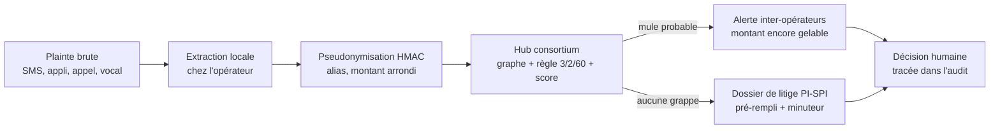

# Cahier des charges — Réclam'Graph

> Cahier des charges de l'aboutissement du produit, du prototype du GPU Challenge 2026 à un service opéré pour un consortium d'émetteurs de l'UEMOA. Chaque exigence a un identifiant suivi dans [suivi-cahier-des-charges.md](../03-suivi/suivi-cahier-des-charges.md).
> Version 1.0 — 25/11/2026.

## Sommaire

1. [Contexte et objectif](#1-contexte-et-objectif)
2. [Utilisateurs et personas](#2-utilisateurs-et-personas)
3. [Parcours principaux](#3-parcours-principaux)
4. [Exigences fonctionnelles](#4-exigences-fonctionnelles)
5. [Exigences non fonctionnelles](#5-exigences-non-fonctionnelles)
6. [Métriques cibles](#6-métriques-cibles)
7. [Choix techniques](#7-choix-techniques)
8. [Direction stratégique](#8-direction-stratégique)
9. [Critères d'acceptation](#9-critères-dacceptation)
10. [Hors périmètre et hypothèses](#10-hors-périmètre-et-hypothèses)

Priorités : **P0** = démonstration du challenge ; **P1** = pilote 8 semaines ; **P2** = production consortium.

---

## 1. Contexte et objectif

| Élément | Contenu |
|---|---|
| Marché | Mobile money UEMOA : 248,7 M comptes, 11,92 Md transactions, 160 415 Md FCFA en 2024 (BCEAO) ; 88 % des dépôts retirés en espèces |
| Problème | 2,65 M réclamations au S2 2021, dominées par l'erreur de bénéficiaire ; fraude dominée par l'ingénierie sociale (arnaque à l'« erreur de dépôt »). Les deux récits sont identiques. PI-SPI rend le transfert irrévocable et place la mule sur un autre réseau que la victime |
| Obligations | Instruction BCEAO 008-05-2015 (art. 18, 30, 35 : remboursement sous 3 jours ouvrés) ; Circulaire 002-2020/CB/C (réponse sous 1 mois) ; Instruction 001-01-2024 ; conventions PI-SPI (délais et pénalités non publics) |
| Objectif produit | Croiser les réclamations entre émetteurs pour lever une alerte « mule probable » avant le retrait, et transformer chaque réclamation légitime en dossier de litige PI-SPI conforme aux délais |
| Promesse | **Une entrée, deux sorties : geler ou rembourser.** Réclam'Graph recommande et documente ; il ne gèle jamais seul |

## 2. Utilisateurs et personas

| Persona | Rôle | Besoin | Indicateur de succès |
|---|---|---|---|
| **Responsable litiges et fraude** (EME ou banque PI-SPI) — utilisateur principal | Décide des gels, pilote les délais | Voir tôt les campagnes, prioriser, prouver la conformité | FCFA récupérés, % dossiers dans les délais, pénalités évitées |
| **Agent de centre de contact** | Reçoit et qualifie la plainte | Dossier pré-rempli, pas de ressaisie | Temps moyen par dossier |
| **Analyste fraude** | Investigue une alerte | Preuves, graphe, historique | Délai de qualification |
| **Équipe PI-Reclam / BCEAO** | Supervision | Vue consolidée des campagnes, conformité par participant | Campagnes détectées, délais tenus par émetteur |
| **Agrégateur (type Payfonte)** | Litiges marchands | Dossiers marchands, alertes sur bénéficiaires | Litiges résolus |
| **Administrateur consortium** | Opère le hub | Gérer participants, clés, seuils | Disponibilité, rotation des clés |

## 3. Parcours principaux

| Parcours | Étapes | Délai cible |
|---|---|---|
| Mule probable | Plainte → extraction → partage → 3e plaignant indépendant sur 2e réseau → alerte → notification des opérateurs → décision humaine de gel | Alerte < 60 s après la plainte déclenchante |
| Erreur sincère | Plainte → extraction → aucune grappe → dossier camt.056 pré-rempli → validation agent → envoi PI-Reclam → minuteur J+3 / J+30 | Dossier prêt < 5 s |
| Incident | Pic de plaintes par (opérateur, typologie) → regroupement → alerte incident | < 15 min après le début du pic |
| Assistant | Question en langage naturel → Nexus répond à partir des données du tableau de bord, cite ses sources, guide vers l'action | < 3 s |

## 4. Exigences fonctionnelles

### EXT — Extraction

| ID | Exigence | Prio |
|---|---|---|
| EXT-01 | Convertir une réclamation brute en fiche structurée : typologie, montant FCFA, heure, alias bénéficiaire, MSISDN, réseau de destination, indices d'arnaque | P0 |
| EXT-02 | Robustesse au bruit : fautes, abréviations SMS, nouchi, mots fon, montants « 25mil », « 25.000F », « vingt cinq mille » | P0 |
| EXT-03 | Sortie JSON guidée (schéma imposé, vLLM guided decoding) ; aucune valeur inventée si absente du texte | P0 |
| EXT-04 | Trois moteurs nommés (`regex-baseline`, `llm`, `heuristic-fallback`), moteur écrit dans chaque sortie | P0 |
| EXT-05 | Entrées multicanal : SMS, application, centre d'appel, note vocale (français seulement, `a_verifier_par_un_humain`) | P1 |
| EXT-06 | Inférence exécutée chez l'opérateur (aucun texte vers un tiers) | P1 |

### PSE — Pseudonymisation

| ID | Exigence | Prio |
|---|---|---|
| PSE-01 | HMAC-SHA256 de l'alias bénéficiaire et du plaignant avec une clé de consortium | P0 |
| PSE-02 | Montant arrondi au pas de 5 000 FCFA avant partage ; montant exact connu du seul opérateur hôte | P0 |
| PSE-03 | Le texte et l'identité du plaignant ne quittent jamais l'opérateur | P0 |
| PSE-04 | Résolution numéro → alias via l'annuaire PI-SPI | P0 |
| PSE-05 | Rotation de clé et gestion par un tiers de confiance | P2 |
| PSE-06 | Intersection d'ensembles privée (PSI) en remplacement du HMAC partagé | P2 |

### HUB — Hub de corrélation

| ID | Exigence | Prio |
|---|---|---|
| HUB-01 | Graphe tripartite plaignants / bénéficiaires / opérateurs | P0 |
| HUB-02 | Règle paramétrable : ≥ 3 plaignants indépendants, ≥ 2 opérateurs, fenêtre glissante 60 min | P0 |
| HUB-03 | Score 0–1 de vraisemblance ; sous le seuil, alerte « à qualifier », jamais supprimée | P0 |
| HUB-04 | Montant encore gelable au moment de l'alerte ; liste des opérateurs à prévenir | P0 |
| HUB-05 | Traitement en flux (événement par événement) au lieu du lot | P1 |
| HUB-06 | Corrélations complémentaires : agent de retrait, montant, heure, alias changeants | P2 |

### RAD — Radar d'incidents

| ID | Exigence | Prio |
|---|---|---|
| RAD-01 | Détection de pic par (opérateur, typologie), base saisonnière robuste (médiane + MAD), seuil ×2 | P0 |
| RAD-02 | Regroupement sémantique (bge-m3) qui nomme l'incident | P0 |
| RAD-03 | Alerte incident diffusée aux participants concernés | P1 |

### DOS — Dossier de litige

| ID | Exigence | Prio |
|---|---|---|
| DOS-01 | Décision GELER / REMBOURSER / A_QUALIFIER par réclamation | P0 |
| DOS-02 | Demande d'annulation pré-remplie, ossature ISO 20022 camt.056, avec preuves extraites | P0 |
| DOS-03 | Rappel d'irrévocabilité PI-SPI dans le dossier | P0 |
| DOS-04 | Validation par un agent avant envoi ; envoi vers PI-Reclam | P1 / P2 |
| DOS-05 | Export PDF et JSON | P1 |

### MIN — Minuteur réglementaire

| ID | Exigence | Prio |
|---|---|---|
| MIN-01 | J+3 jours ouvrés (art. 35) avec week-ends et fériés | P0 |
| MIN-02 | J+30 jours calendaires (Circulaire CB) | P0 |
| MIN-03 | Échéance PI-Reclam paramétrable, marquée « non publique » | P0 |
| MIN-04 | Alertes avant échéance (J-1, H-4) par e-mail et dans la plateforme | P1 |

### AUD — Audit

| ID | Exigence | Prio |
|---|---|---|
| AUD-01 | Journal append-only de chaque décision (alerte, recommandation, dossier) avec preuves et validateur humain | P0 |
| AUD-02 | Chaînage par hachage et vérification d'intégrité | P0 |
| AUD-03 | Ancrage externe périodique du dernier hachage (horodatage tiers) | P2 |
| AUD-04 | Export du journal pour la Commission bancaire | P1 |

### WEB — Plateforme web

| ID | Exigence | Prio |
|---|---|---|
| WEB-01 | Page d'accueil produit (hero animé Three.js, proposition de valeur, défilement des EME du consortium, preuves chiffrées, pied de page) | P0 |
| WEB-02 | Connexion professionnelle, comptes de démonstration par rôle | P0 |
| WEB-03 | Tableau de bord qui guide : vue d'ensemble (« ce qui demande votre décision maintenant »), alertes mules, dossiers et minuteurs, graphe, incidents, preuves, audit | P0 |
| WEB-04 | Lecture des données de `results/` en mode démo ; API en cible | P0 / P1 |
| WEB-05 | CGU, politique de confidentialité, mentions légales | P0 |
| WEB-06 | Icônes et illustrations SVG ; aucune emoji ; accessible (contraste AA, clavier) | P0 |
| WEB-07 | Rôles et permissions (responsable, agent, analyste, régulateur, admin) | P1 |
| WEB-08 | Action « recommander le gel » et « valider le dossier » écrites dans l'audit | P1 |

### ASSIST — Assistant Nexus

| ID | Exigence | Prio |
|---|---|---|
| ASSIST-01 | Assistant nommé **Nexus**, présent dans tout le tableau de bord, qui guide l'utilisateur vers la prochaine action | P0 |
| ASSIST-02 | Répond à partir des données affichées (alertes, dossiers, métriques) et cite la source | P0 |
| ASSIST-03 | Explique le graphe : quelles EME sont reliées par quelle grappe, pourquoi une alerte a été levée | P0 |
| ASSIST-04 | Ne recommande jamais un gel automatique ; rappelle la décision humaine | P0 |
| ASSIST-05 | LLM local (même serveur vLLM) en production, réponses ancrées (RAG sur les données de l'utilisateur) | P1 |

### API — Interface programmatique

| ID | Exigence | Prio |
|---|---|---|
| API-01 | API REST FastAPI : `/complaints`, `/alerts`, `/dossiers`, `/incidents`, `/metrics`, `/assistant` (voir [api.md](../01-general/api.md)) | P1 |
| API-02 | Authentification par jeton (OAuth2 client credentials pour les opérateurs) | P1 |
| API-03 | Webhooks d'alerte vers les SI des opérateurs | P2 |
| API-04 | Connecteur PI-Reclam | P2 |

### SEC — Sécurité

| ID | Exigence | Prio |
|---|---|---|
| SEC-01 | Aucun secret dans le dépôt ; `.env` ignoré ; clé de consortium hors dépôt | P0 |
| SEC-02 | Sessions signées, cookies `HttpOnly`, `Secure`, `SameSite=Lax` | P0 |
| SEC-03 | Cloisonnement par participant : un opérateur ne voit que ses plaintes et les alertes qui le concernent | P1 |
| SEC-04 | Chiffrement au repos et en transit (TLS 1.3) | P1 |
| SEC-05 | Journalisation des accès, détection d'abus, limitation de débit | P1 |
| SEC-06 | Test d'intrusion avant pilote | P1 |

## 5. Exigences non fonctionnelles

| ID | Domaine | Exigence |
|---|---|---|
| NF-01 | Latence | Alerte « mule probable » émise en **< 60 s** après la plainte déclenchante (P1) |
| NF-02 | Débit | ≥ 50 réclamations/s en extraction LLM sur un GPU T4 (à mesurer ; cible de dimensionnement) |
| NF-03 | Disponibilité | 99,5 % en pilote, 99,9 % en production |
| NF-04 | Données personnelles | Conformité loi béninoise 2017-20 (Code du numérique, APDP), lois équivalentes UEMOA (Sénégal CDP, Côte d'Ivoire ARTCI, Togo IPDCP) ; analyse d'impact (AIPD) avant pilote ; RGPD si traitement en UE |
| NF-05 | Localisation | Hébergement dans la zone UEMOA (ou chez l'opérateur pour l'extraction) ; aucun texte de plainte hors zone |
| NF-06 | Minimisation | Seuls alias haché, plaignant haché, opérateur, horodatage, typologie, montant arrondi quittent l'opérateur |
| NF-07 | Explicabilité | Chaque alerte liste ses preuves (identifiants de réclamations, seuils atteints, score détaillé) |
| NF-08 | Reproductibilité | Toute métrique publiée est régénérable par une commande |
| NF-09 | Accessibilité | WCAG 2.1 AA sur la plateforme web |
| NF-10 | Langue | Français ; anglais en P2 |
| NF-11 | Coût | Coût d'inférence publié pour 1 000 réclamations, mesuré |

## 6. Métriques cibles

| Métrique | Définition | Référence (opérateur seul) | Mesuré 25/11 (synthétique) | Cible pilote |
|---|---|---|---|---|
| Rappel des campagnes de mules | Campagnes détectées / campagnes réelles | 60 % (3/5) | **100 %** (5/5) | ≥ 80 % |
| Précision après score | Alertes prioritaires vraies / alertes prioritaires | 75 % | 42 % brute, **100 %** après score | ≥ 70 % |
| Délai médian de détection | Minutes entre 1re plainte et alerte | 29 min | **13 min** | ≤ 15 min |
| FCFA gelables | Somme `total − retiré(t_alerte)` | 367 000 | **920 000** | Mesuré sur historique |
| F1 extraction par champ | F1 récupérable et brute, par champ | regex 0,959 | heuristique 0,982 ; **LLM non mesuré** | ≥ 0,95 sur montant |
| F1 typologie (macro) | — | TF-IDF supervisé 0,98 | 0,807 zero-shot | Non critique |
| Débit GPU | Réclamations/s en extraction LLM | — | **non mesuré** | ≥ 50/s sur T4 |
| Coût d'inférence | FCFA / 1 000 réclamations | API cloud 70,68 ; humain 270 000 (estimation) | **non calculé** | Publié, mesuré |
| Dossiers dans les délais | % dossiers clos avant J+3 ouvrés | Non mesuré | — | ≥ 95 % |
| Radar d'incidents | Rappel / précision | — | 100 % / 50 % | ≥ 90 % / ≥ 70 % |

## 7. Choix techniques

| Couche | Choix | Justification | Alternatives écartées |
|---|---|---|---|
| Pipeline, ML | **Python 3.13+** | Écosystème vLLM, sentence-transformers, networkx, scikit-learn ; code existant testé | — |
| LLM | **Qwen2.5-7B-Instruct-AWQ** sur **vLLM** (3B sous 12 Go) | Multilingue, bon en français, JSON guidé, tient sur T4 en AWQ | API cloud : texte hors opérateur ; Llama 3 : français plus faible |
| Embeddings | **bge-m3** | Multilingue, 1024 dim, déjà dans Réclam'Radar | E5, TF-IDF (repli seulement) |
| Graphe | **networkx** (P0), **PostgreSQL + Apache AGE** ou **Neo4j** (P2) | networkx suffit en lot ; en production, requêtes graphe persistantes et fenêtres temporelles | Graphe en mémoire seul : pas de persistance |
| API | **FastAPI** (P1) | Même langage que le pipeline, schémas pydantic déjà écrits, OpenAPI généré | Flask, Node |
| Plateforme web | **TypeScript, Next.js (App Router), React, Three.js** | Rendu serveur, routes protégées, animations 3D du hero, déploiement simple | Streamlit (conservé pour la démo technique, limité pour un produit) |
| Données | Fichiers JSON (P0) ; **PostgreSQL** (P1) | Transactions, contraintes, journal d'audit | — |
| File d'événements | **Redis Streams** ou **NATS** (P2) | Flux temps réel opérateur → hub | Kafka (lourd pour le volume) |
| Confidentialité | HMAC-SHA256 (P0) ; **PSI** (OpenMined PSI ou équivalent) ou hub tiers (P2) | Un HMAC reste attaquable par dictionnaire si la clé fuit | Chiffrement homomorphe : trop coûteux |
| Hébergement | GPU chez l'opérateur ou cloud souverain UEMOA ; hub chez un tiers de confiance | Localisation des données | Hyperscaler hors zone pour le texte |

## 8. Direction stratégique

1. **Positionnement** : couche d'intelligence de PI-Reclam, pas concurrent. Scénario de sortie : intégration ou rachat par l'opérateur du hub (BCEAO, Alliance Fintech UEMOA).
2. **Effet de réseau** : chaque opérateur ajouté augmente le rappel de tous. Premier consortium : deux opérateurs d'un même pays (Bénin).
3. **Ce qu'on vend** : baisse du coût de traitement, conformité aux délais, confiance ; pas les économies de fraude (valeur déclarée faible).
4. **Prix (hypothèse)** : 5 FCFA par réclamation analysée ou forfait 3–5 M FCFA/mois par grand opérateur et par pays ; option 5 % des fonds récupérés.
5. **Argument GPU** : souveraineté (le texte reste chez l'opérateur, inférence locale open-weight), débit mesuré, pas le coût unitaire (l'API cloud est moins chère, c'est mesuré).

## 9. Critères d'acceptation

| Jalon | Critère |
|---|---|
| **Démo challenge (P0)** | `make all` vert ; `results/` régénéré avec le moteur LLM sur T4 ou étiquette corrigée ; plateforme web : landing, connexion, tableau de bord, Nexus, CGU, confidentialité, `npm run build` vert ; démo de 3 min répétée |
| **Pilote (P1)** | Historique réel anonymisé d'un opérateur (≥ 10 000 réclamations) ; AIPD validée ; API FastAPI ; rappel ≥ 80 %, précision ≥ 70 % sur campagnes qualifiées par l'opérateur ; alerte < 60 s ; 0 donnée nominative hors opérateur (test) |
| **Production (P2)** | ≥ 2 opérateurs connectés ; PSI ou hub tiers ; disponibilité 99,9 % ; test d'intrusion sans faille critique ; connecteur PI-Reclam |

## 10. Hors périmètre et hypothèses

| Hors périmètre | Raison |
|---|---|
| Gel automatique | Décision humaine non négociable |
| Langues locales à l'oral | WER publiés incompatibles (Whisper > 97 % en wolof) |
| Message ISO 20022 certifié | Validation par un participant PI-SPI nécessaire |

| Hypothèse | Statut |
|---|---|
| ~10 M réclamations/an dans l'Union | Extrapolation non sourcée |
| Coût humain 270–700 FCFA par réclamation | Estimation (offres d'emploi) |
| Délais et pénalités PI-Reclam | Non publics |
| Règle du 2/11/2026 | Sources secondaires, à vérifier sur le communiqué BCEAO |
| Base légale du partage pseudonymisé | Non vérifiée (APDP, BCEAO) |
