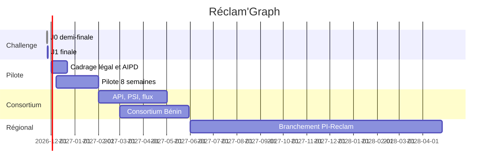

# Roadmap — Réclam'Graph

> Du passage en demi-finale (25/11/2026) au branchement sur PI-Reclam (mi-2028). Chaque phase a un livrable et une métrique de sortie : on ne passe à la suivante que si la métrique est atteinte.
> Mise à jour : 25/11/2026.

## Vue d'ensemble

| Phase | Période | Objectif | Métrique de sortie |
|---|---|---|---|
| **J0** | 25/11, avant 16 h | Passer en finale | Qualification (6 sur 12) |
| **J1** | 26/11 | Gagner la finale, obtenir un contact pilote | Classement ; ≥ 1 « on testerait » d'un opérateur ou agrégateur |
| **Pilote** | 8 semaines (déc. 2026 – fév. 2027) | Valider sur historique réel anonymisé d'un opérateur | Rappel ≥ 80 %, précision ≥ 70 %, AIPD validée |
| **6 mois** | → mai 2027 | Premier consortium : 2 opérateurs au Bénin | Alertes inter-opérateurs en flux < 60 s ; 1er contrat |
| **18 mois** | → mai 2028 | Couche d'intelligence de PI-Reclam, extension UEMOA | ≥ 5 clients, 0,1–0,25 M$ ARR (hypothèse SOM) |

## J0 — 25/11, avant le passage (≈ 16 h 00)

| Créneau | Action | Qui | Livrable |
|---|---|---|---|
| 12 h 00 | Vérifier que les livrables sont déposés sur le formulaire | Joachim | Accusé de dépôt |
| 12 h 00 – 13 h 00 | **Run GPU réel** : `make serve-llm`, `record_gpu_evidence.sh`, `make pipeline-llm`, `make bench-llm` (voir [analyse-depot.md §5](analyse-depot.md#5-marche-à-suivre-sur-la-machine-gpu)) | Pacôme | `results/` avec moteur `llm`, débit et coût mesurés |
| 12 h 00 – 14 h 00 | Plateforme web : landing, connexion, tableau de bord, Nexus, CGU, confidentialité ; vérifiée dans le navigateur | Joachim + agents | Branche `feat/plateforme-web`, PR |
| 13 h 00 – 13 h 30 | Si le run GPU échoue : corriger l'étiquette « GPU run » et préparer la phrase GPU honnête | Pacôme | Résultats cohérents |
| 14 h 00 – 14 h 30 | Mettre à jour `PITCH.md` : argument GPU = souveraineté + débit mesuré | Joachim | Pitch v2 |
| 14 h 30 – 15 h 00 | Enregistrer la vidéo de secours de la démo (3 min) | Joachim | Fichier vidéo local |
| 15 h 00 – 15 h 45 | Deux répétitions chronométrées 5 + 3 + 5, un coéquipier joue le jury (questions de [analyse-challenge.md §7](analyse-challenge.md#7-questions-que-le-jury-posera)) | Équipe | Temps tenus |
| ~16 h 00 | Passage | Équipe | — |

## J1 — 26/11, finale

| Créneau | Action |
|---|---|
| Soir du 25/11 | Intégrer les retours du jury ; préparer 7 min de questions (au lieu de 5) |
| 07 h 45 | Test technique : démo en mode pré-calculé, plateforme web en local, vidéo de secours sur clé USB |
| 09 h 00 – 12 h 00 | Fintech Academia : noter les phrases du panel « paiements, fraude, données et régulation » à réutiliser dans le pitch |
| 12 h 00 – 13 h 45 | Déjeuner et rencontres : viser un opérateur et Payfonte, obtenir un contact pour le pilote |
| 14 h 00 | Finale, 15 min (5 + 3 + 7) |

## Pilote — 8 semaines

| Semaine | Jalon | Livrable | Métrique |
|---|---|---|---|
| S0 (avant) | Lettre d'intérêt, convention de pilote, consultation APDP | AIPD, convention | Accord signé |
| S1–S2 | Historique anonymisé (≥ 10 000 réclamations) ; validation du générateur synthétique contre le réel | Rapport d'écart synthétique/réel | Distributions comparées |
| S3–S4 | Extraction LLM sur données réelles, déployée chez l'opérateur | F1 par champ sur 500 réclamations annotées | F1 montant ≥ 0,95 |
| S5–S6 | Campagnes qualifiées par l'équipe fraude ; mesure du rappel et de la précision | Rapport de mesure | Rappel ≥ 80 %, précision ≥ 70 % |
| S7 | API FastAPI, plateforme web branchée sur l'API | Version pilote | Alerte < 60 s |
| S8 | Restitution, proposition commerciale | Bilan, offre | Décision de l'opérateur |

## 6 mois — premier consortium

| Jalon | Livrable | Métrique |
|---|---|---|
| Deuxième opérateur béninois | Convention de consortium sous l'égide d'Alliance Fintech UEMOA | 2 opérateurs connectés |
| Confidentialité de production | PSI ou hub opéré par un tiers de confiance, rotation des clés | Audit de sécurité sans faille critique |
| Temps réel | Flux événementiel opérateur → hub | Alerte < 60 s en continu |
| Produit | Rôles, validation des dossiers, notifications de délais | % dossiers dans les délais ≥ 95 % |
| Commercial | Premier contrat | 1 client payant |

## 18 mois — régional

| Jalon | Livrable | Métrique |
|---|---|---|
| Proposition BCEAO | Branchement sur PI-Reclam comme couche d'intelligence | Accord de principe |
| Extension UEMOA | Sénégal, Côte d'Ivoire, Togo | ≥ 5 clients |
| Extension hors UEMOA | GIMACPAY (CEMAC), autres systèmes de paiement instantané | Étude d'opportunité |
| Revenus | Forfaits + usage | 0,1–0,25 M$ ARR (hypothèse) |
