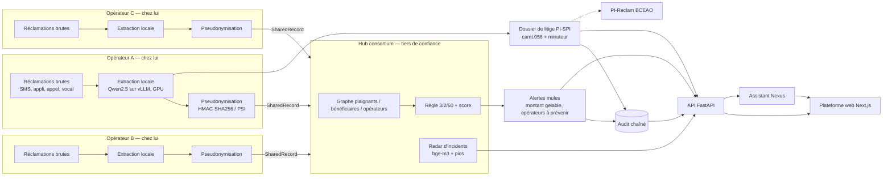
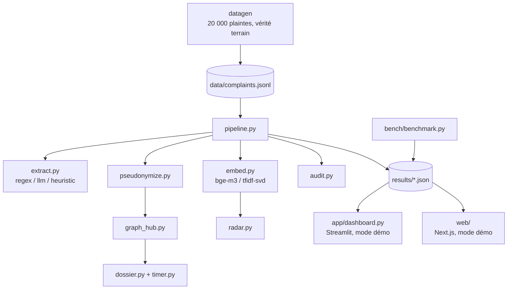
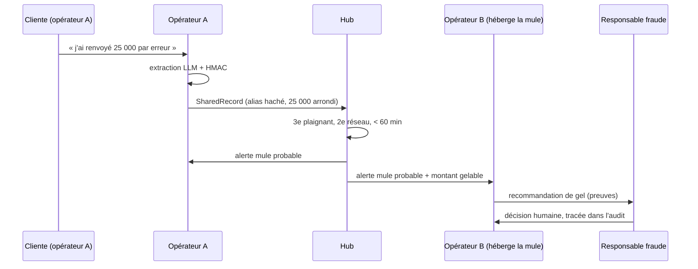

# Architecture

> Vue d'ensemble de Réclam'Graph : composants, flux de données, frontière de confiance, et passage de l'architecture du prototype (lot, fichiers) à l'architecture cible (flux, API, consortium).
> Mise à jour : 25/11/2026.

## Sommaire

1. [Principe](#1-principe)
2. [Architecture cible](#2-architecture-cible)
3. [Architecture du prototype](#3-architecture-du-prototype)
4. [Frontière de confiance](#4-frontière-de-confiance)
5. [Flux d'une réclamation](#5-flux-dune-réclamation)
6. [Choix structurants](#6-choix-structurants)
7. [Contraintes non fonctionnelles](#7-contraintes-non-fonctionnelles)

---

## 1. Principe

Lire → pseudonymiser → croiser → agir. Les deux premières étapes ont lieu **chez chaque opérateur** ; seule la troisième a lieu au **hub** ; la quatrième revient à l'opérateur (décision humaine).

## 2. Architecture cible

| Composant | Où il tourne | Responsabilité | Technologie |
|---|---|---|---|
| Extraction | Chez l'opérateur, GPU | Fiche structurée depuis le texte brut | vLLM + Qwen2.5-7B-AWQ, JSON guidé |
| Pseudonymisation | Chez l'opérateur | `SharedRecord` sans donnée nominative | HMAC-SHA256 (P0), PSI (P2) |
| Hub graphe | Tiers de confiance | Corrélation inter-opérateurs, règle, score, montant gelable | networkx (P0), PostgreSQL + AGE ou Neo4j (P2) |
| Radar d'incidents | Hub | Pics par (opérateur, typologie), regroupement | bge-m3, médiane + MAD |
| Dossier + minuteur | Chez l'opérateur | Demande d'annulation, échéances réglementaires | Python, pydantic |
| Audit | Opérateur et hub | Journal append-only chaîné | JSONL (P0), PostgreSQL (P1) |
| API | Hub / opérateur | Exposer alertes, dossiers, métriques, assistant | FastAPI |
| Plateforme web | Cloud UEMOA | Tableau de bord par rôle, assistant | Next.js, React, Three.js |
| Assistant Nexus | Plateforme web + LLM local | Guider, expliquer le graphe, citer les sources | Règles + données (P0), RAG sur LLM local (P1) |

## 3. Architecture du prototype

Le prototype fonctionne **par lot** : tout le corpus est traité, les sorties sont écrites dans `results/`, et les interfaces rejouent `results/demo_bundle.json`. Cela garantit une démo sans dépendance à une session GPU en direct.

## 4. Frontière de confiance

| Champ | Reste chez l'opérateur | Part au hub |
|---|---|---|
| Texte de la réclamation | Oui | Non |
| Identité et numéro du plaignant | Oui | Haché (HMAC) |
| Alias du bénéficiaire | Oui | Haché (HMAC) |
| Opérateur, horodatage, typologie | Oui | Oui |
| Montant | Exact | Arrondi au pas de 5 000 FCFA |
| Indices d'arnaque extraits du texte | Oui | Non |

Limite connue : un HMAC sur des numéros de téléphone est attaquable par dictionnaire si la clé fuit. Production : PSI ou hub opéré par un tiers de confiance (BCEAO, PI-Reclam, Alliance Fintech UEMOA).

## 5. Flux d'une réclamation

## 6. Choix structurants

| Choix | Justification |
|---|---|
| Inférence locale chez l'opérateur | Le texte contient des données personnelles ; il ne quitte ni l'opérateur ni la zone |
| Règle explicite + score, plutôt qu'un modèle opaque | Explicable au régulateur ; seuils visibles |
| Décision humaine | Risque de gel à tort d'un innocent |
| Mode démo par défaut | Démo indépendante du GPU et du réseau |
| Un seul client LLM compatible OpenAI | vLLM, Ollama, ou autre serveur interchangeables |
| Plateforme web séparée du pipeline | Le pipeline reste mesurable et testé ; l'interface évolue sans toucher aux chiffres |

## 7. Contraintes non fonctionnelles

| Contrainte | Cible | Où elle est traitée |
|---|---|---|
| Latence alerte | < 60 s (pilote) | Hub en flux (P1) |
| Confidentialité | Minimisation stricte | `pseudonymize.py`, PSI (P2) |
| Localisation | Zone UEMOA | Hébergement |
| Traçabilité | Chaque décision auditée | `audit.py` |
| Reproductibilité | Une commande par métrique | `Makefile` |
| Scalabilité | ~2 M réclamations/an par grand opérateur (≈ 0,06/s en moyenne, pics × 100) | Un T4 suffit si le débit mesuré ≥ 50/s |
